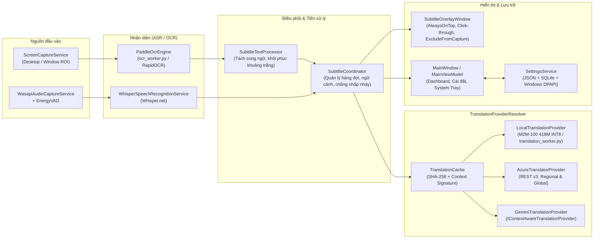

# ScreenSub AI — Tổng Quan & Tài Liệu Kỹ Thuật Dự Án

> **Phiên bản mục tiêu:** `1.0.0-beta.1`  
> **Nền tảng:** Windows 10 / 11 x64 (`.NET 10` WPF + Python Workers)  
> **Cập nhật lần cuối:** 2026-11-13  

---

## 1. Giới thiệu tổng quan

**ScreenSub AI** là ứng dụng Windows Desktop chuyên **nhận diện và dịch phụ đề thời gian thực (Realtime Subtitle Translator)** cho 3 ngôn ngữ chính: **Tiếng Anh (`en`)**, **Tiếng Trung (`zh`)** và **Tiếng Việt (`vi`)**.

Ứng dụng được thiết kế theo kiến trúc **Modular Clean Architecture + MVVM**, tách biệt tầng nghiệp vụ .NET với các tiến trình AI Python nền (JSON-lines qua `stdin/stdout`) nhằm đạt độ trễ thấp, không rò rỉ tiến trình con và bảo vệ dữ liệu người dùng.

### Hai nguồn đầu vào độc lập & Chế độ kết hợp (`TranslationMode`)
1. **Screen OCR (`ScreenOcr`)**: Chụp vùng phụ đề trên màn hình hoặc theo dõi cửa sổ ứng dụng (YouTube, Netflix, VLC, game, livestream...), nhận diện văn bản qua **RapidOCR ONNX / PaddleOCR** và dịch tức thời.
2. **Audio Realtime (`AudioRealtime`)**: Thu âm thanh hệ thống qua **WASAPI Loopback** (không cần micro ngoài hay virtual cable), phát hiện đoạn hội thoại bằng **Energy VAD**, chuyển giọng nói thành văn bản cục bộ qua **Whisper.net**.
3. **Hybrid (`Hybrid`)**: Kết hợp đồng thời cả 2 luồng OCR và Audio.

### Ba chế độ động cơ dịch (`TranslationEngineMode`)
* **Offline (`Offline` — Strict Offline)**: Dịch 100% cục bộ bằng mô hình **M2M-100 418M INT8 (CTranslate2)**, không thực hiện bất kỳ kết nối mạng nào.
* **Online (`Online`)**: Cho phép chọn giữa **Azure AI Translator** (tốc độ cao, ổn định) hoặc **Gemini Contextual AI** (dịch tự nhiên theo ngữ cảnh các câu thoại gần nhất).
* **Tự động (`Auto`)**: Định tuyến theo `AutoFallbackPolicy` (`PreferOffline`, `PreferOnline`, `ManualOnly`) và tùy chọn `AllowCloudFallbackOnOfflineFailure` (mặc định `false` để bảo vệ quyền riêng tư).

---

## 2. Kiến trúc hệ thống & Sơ đồ luồng dữ liệu

---

## 3. Cấu trúc thư mục & Chi tiết các module (`ScreenSubAI.slnx`)

Giải pháp [ScreenSubAI.slnx](file:///d:/ScreenSub%20AI/ScreenSubAI.slnx) gồm **9 project .NET (`src/`)**, **2 bộ test (`tests/`)**, **2 Python worker (`workers/`)**, bộ tài liệu (`docs/`) và script đóng gói (`installer/`).

### 3.1. Các project .NET trong `src/`

| Project | Vai trò chính | Các thành phần / file tiêu biểu |
| :--- | :--- | :--- |
| **ScreenSub.Core** | Định nghĩa models, enums, interfaces và logic xử lý chuỗi phụ đề dùng chung | - `AppEnums.cs`: `TranslationMode`, `TranslationEngineMode`, `OnlineTranslationProviderType`, `DisplayMode`, `SourceLanguage`, `TargetLanguage`, `SystemState`, `ModelRuntimeState`... - `Models/`: `AppSettings`, `SubtitleItem`, `TranslationResult`, `OcrResult`, `ScreenRegion`, `WindowInfo`, `HardwareInfo`, `ModelMetadata` - `Interfaces/`: `ITranslationProvider`, `IContextAwareTranslationProvider`, `ITranslationProviderResolver`, `ISubtitleCoordinator`, `IScreenCaptureService`, `IOcrEngine`, `ISettingsService` - `Processing/SubtitleTextProcessor.cs`: tách dòng song ngữ, lọc nhiễu UI/timestamp, khôi phục khoảng trắng (`RestoreWordSpacing`), nhận diện ngôn ngữ (`DetectLanguage`), hậu xử lý câu dịch tự nhiên (`CleanTranslationOutput`) |
| **ScreenSub.Capture** | Chụp vùng màn hình, xử lý DPI đa màn hình và theo dõi cửa sổ đích | - `ScreenCaptureService.cs`: chụp vùng desktop/cửa sổ (`CaptureRegionAsync`, `CaptureWithDiagnosticsAsync`) - `WindowRegionTracker.cs`: bám tọa độ khi cửa sổ mục tiêu di chuyển/đổi kích thước (`FollowWindow`) - `FrameChangeDetector.cs`: phát hiện thay đổi khung hình theo ngưỡng `FrameDiffThreshold` (tránh gọi OCR thừa khi chữ chưa đổi) - `NativeMethods.cs`: P/Invoke Win32 API |
| **ScreenSub.Ocr** | Kết nối và điều khiển tiến trình Python OCR nền | - `PaddleOcrEngine.cs`: khởi chạy và giao tiếp JSON-lines với `workers/paddle-ocr/ocr_worker.py`, dọn tiến trình con qua `ProcessExit` - `TextNormalizer.cs`: chuẩn hóa văn bản OCR |
| **ScreenSub.Audio** | Thu âm thanh hệ thống và cắt đoạn thoại thời gian thực | - `Capture/WasapiAudioCaptureService.cs`: WASAPI Loopback capture, đo Peak/RMS audio level - `Processing/AudioResampler.cs`: chuẩn hóa PCM cho Whisper - `VAD/EnergyVoiceActivityDetector.cs`: phát hiện bắt đầu/kết thúc câu nói theo ngưỡng năng lượng và `VadHangoverMs` |
| **ScreenSub.Speech** | Nhận diện giọng nói cục bộ bằng Whisper.net | - `Whisper/WhisperSpeechRecognitionService.cs`: chuyển `SpeechSegment` thành văn bản - `Whisper/WhisperModelManager.cs`: quản lý file model Whisper (vd: `ggml-base.bin`) |
| **ScreenSub.Translation** | Tầng dịch thuật AI đa động cơ, cache và quản lý ngữ cảnh | - `LocalNeuralTranslationEngine.cs`: quản lý tiến trình `translation_worker.py` (M2M-100 418M INT8 trên CPU AVX2 hoặc CUDA) - `LocalTranslationProvider.cs`: provider Offline AI, tự nhận diện ngôn ngữ và bỏ qua dịch nếu nguồn trùng đích - `AzureTranslatorProvider.cs`: gọi Azure Translator REST v3 (hỗ trợ cả Regional & Global khi region rỗng, custom endpoint, `TestConnectionAsync`) - `GeminiTranslationProvider.cs`: triển khai `IContextAwareTranslationProvider`, gửi tối đa 3 câu thoại gần nhất (`RecentConversationContext` trong vòng 60s) để giữ đúng đại từ/văn phong, có timeout 6s và cooldown 15s khi gặp HTTP 429 - `TranslationProviderResolver.cs`: chọn provider theo mode (`Offline`/`Online`/`Auto`) và chính sách fallback - `TranslationCache.cs`: cache SHA-256 theo `(Text + Source + Targets + ContextSignature)`, loại trừ các chuỗi lỗi `[MODEL NOT INSTALLED` / `[Gemini` |
| **ScreenSub.Overlay** | Cửa sổ phụ đề nổi trên cùng màn hình | - `SubtitleOverlayWindow.xaml` & `.xaml.cs`: nền bán trong suốt, bo góc, bỏ `DropShadowEffect` ngoài để tránh DWM blank-frame flicker, dùng frozen brush cache, hỗ trợ **Single / Dual / Triple**, Edit Mode để kéo vị trí, Always on Top - `OverlayNativeMethods.cs`: thiết lập **Click-through** (`WS_EX_TRANSPARENT`) và **Capture Exclusion** (`WDA_EXCLUDEFROMCAPTURE`) chống OCR quét ngược chính phụ đề |
| **ScreenSub.Infrastructure** | Hạ tầng cấu hình, bảo mật, phần cứng và quản lý model | - `SettingsService.cs`: đọc/ghi `settings.json`, lưu lịch sử dịch trong SQLite (`screensub.db`), mã hóa/xóa `AzureApiKey` và `GeminiApiKey` qua DPAPI - `WindowsSecretStore.cs`: bọc `ProtectedData.Protect` / `Unprotect` (`DataProtectionScope.CurrentUser`) - `HardwareCapabilityDetector.cs`: đọc thông tin CPU/AVX2, GPU/VRAM, RAM, dung lượng đĩa trống - `LocalModelManager.cs`: quản lý tải/kiểm tra thư mục model cục bộ tại `%LocalAppData%\ScreenSubAI\Models` |
| **ScreenSub.Desktop** | Giao diện WPF MVVM, điều phối pipeline và tích hợp Windows | - `App.xaml` & `App.xaml.cs`: cấu hình DI container (Microsoft.Extensions.DependencyInjection), Serilog và xử lý thoát ứng dụng - `MainWindow.xaml` & `.xaml.cs`: Dashboard giám sát trực tiếp (Live Preview, kết quả gốc/dịch, độ trễ) và tab Cài đặt (bao gồm chọn Azure/Gemini, Endpoint, Test Connection, Hardware Diagnostics, Model Manager) - `ViewModels/MainViewModel.cs`: binding toàn bộ trạng thái, đồng bộ cài đặt (`SyncSettings`, `SaveSettingsAsync`, `TestOnlineConnectionAsync`) - `Services/SubtitleCoordinator.cs`: vòng lặp Capture→OCR→Translate→Overlay và Speech→Translate→Overlay, lưu `RecentConversationContext` (5 câu gần nhất), bảo vệ chống ẩn/hiện Overlay liên tục (`>= 16` blank frames & timeout `6500ms`/`7500ms`) - `Views/RegionSelectionWindow.xaml(.cs)`: chọn vùng phụ đề kiểu Snipping Tool hỗ trợ `PerMonitorV2` DPI - `Services/GlobalHotkeyManager.cs`: phím tắt toàn cục mặc định `Ctrl + Alt + Q` - `Services/SystemTrayManager.cs`: chạy nền dưới khay hệ thống |

### 3.2. Các Python Workers (`workers/`)

* **`workers/paddle-ocr/ocr_worker.py`**:
  * Sử dụng **RapidOCR ONNX** (`rapidocr_onnxruntime`) hoặc **PaddleOCR**.
  * Tự động upscale ảnh crop có chiều cao `< 64px` bằng thuật toán Lanczos (tới ~75px) trước khi OCR để mở rộng khoảng trắng giữa các từ tiếng Anh/Latin.
  * Áp dụng `restore_word_spacing` làm sạch khoảng trắng CJK/CamelCase/dấu câu và trả về tọa độ bounding box + confidence qua JSON-lines.
* **`workers/translation/translation_worker.py`**:
  * Chạy **CTranslate2** (`int8` trên CPU hoặc `int8_float16` trên CUDA) + `transformers.M2M100Tokenizer` cho mô hình **M2M-100 418M**.
  * Tự tìm model tại `%LocalAppData%\ScreenSubAI\Models\translation\m2m100_418m_ct2`.
  * Sử dụng decoding `beam_size >= 2`, `length_penalty=0.6`, `repetition_penalty=1.15`, `no_repeat_ngram_size=3`, kết hợp `preprocess_source_for_nmt` (chuẩn hóa cụm động từ/thành ngữ tiếng Anh & CJK OOV) và `refine_target_translation`.

---

## 4. Cơ chế cấu hình, lưu trữ & bảo mật

* **Thư mục dữ liệu runtime**: `%LocalAppData%\ScreenSubAI\`
  * `settings.json`: lưu toàn bộ cấu hình ứng dụng (các API Key luôn bị xóa trắng trước khi serialize ra JSON).
  * `screensub.db` (SQLite): gồm 2 bảng `Secrets` (chứa `CipherValue` mã hóa bằng Windows DPAPI theo user hiện tại) và `TranslationHistory`.
  * `Logs\`: log xoay vòng theo ngày qua Serilog.
  * `Models\`: chứa các trọng số AI cục bộ (ví dụ `translation\m2m100_418m_ct2\model.bin` ~487.9 MB).
* **DPI Awareness**: Khai báo `PerMonitorV2, PerMonitor` trong `src/ScreenSub.Desktop/app.manifest` giúp chọn vùng và hiển thị chính xác trên màn hình 100%, 125%, 150%, 200% DPI và màn hình phụ có tọa độ âm.

---

## 5. Đóng gói, Kiểm thử & Trạng thái Build hiện tại

### 5.1. Bộ kiểm thử tự động (`tests/`)
* **`tests/UnitTests/UnitTests.csproj`**: **64/64 PASS** — bao phủ `AudioTests`, `ContextAwareTranslationTests` (Gemini context isolation, 429 cooldown, định tuyến provider, Azure Global region/trim key, DPAPI secret save/delete), `FrameChangeDetectorTests`, `HardwareAndModelTests`, `OfflineTranslationTests`, `SubtitleTextProcessorTests`, `TextNormalizerTests`, `TranslationCacheTests`.
* **`tests/IntegrationTests/IntegrationTests.csproj`**: **31/31 PASS** *(chạy sau toàn bộ thay đổi trong `src/` trước bước thêm 2 unit test cuối)* — kiểm tra pipeline Audio, End-to-End OCR→Translate, Phase 9 Offline AI, DPAPI SettingsService, Quick Translate & Lifecycle.
* **Script đánh giá Python**: `benchmark_120_sentences.py`, `benchmark_30_sentences_6_directions.py`, `quality_evaluation_suite.py`, `stability_soak_test.py`.

### 5.2. Đóng gói & Phát hành (`installer/` & `publish/`)
* **Inno Setup 6** ([installer/ScreenSubAI_Setup.iss](file:///d:/ScreenSub%20AI/installer/ScreenSubAI_Setup.iss) & `build_installer.ps1`): đóng gói bộ cài đặt Windows x64 (`ScreenSubAI_v1.0.0-beta.1_Setup_x64.exe` vào `dist/`).
* **Bản Publish Release mới nhất**: `publish/ScreenSubAI_latest/ScreenSub.Desktop.exe` (build với `dotnet publish src/ScreenSub.Desktop/ScreenSub.Desktop.csproj -c Release -r win-x64 --self-contained false`, đồng bộ `workers/` đầy đủ).

---

## 6. Tài liệu liên quan trong `docs/`

* [docs/ARCHITECTURE.md](file:///d:/ScreenSub%20AI/docs/ARCHITECTURE.md) — Kiến trúc chi tiết hệ thống.
* [docs/USER_GUIDE.md](file:///d:/ScreenSub%20AI/docs/USER_GUIDE.md) — Hướng dẫn sử dụng OCR, Audio, Overlay và phím tắt.
* [docs/INSTALL.md](file:///d:/ScreenSub%20AI/docs/INSTALL.md) — Hướng dẫn cài đặt môi trường & Python workers.
* [docs/MODEL_GUIDE.md](file:///d:/ScreenSub%20AI/docs/MODEL_GUIDE.md) — Thông số & quản lý mô hình AI cục bộ.
* [docs/TEST_REPORT.md](file:///d:/ScreenSub%20AI/docs/TEST_REPORT.md) & [docs/QA-REPORT-REALWORLD.md](file:///d:/ScreenSub%20AI/docs/QA-REPORT-REALWORLD.md) — Báo cáo kiểm thử và QA thực tế.
* [docs/KNOWN_ISSUES.md](file:///d:/ScreenSub%20AI/docs/KNOWN_ISSUES.md) & [docs/CHANGELOG.md](file:///d:/ScreenSub%20AI/docs/CHANGELOG.md) — Các vấn đề đã biết & lịch sử thay đổi.
