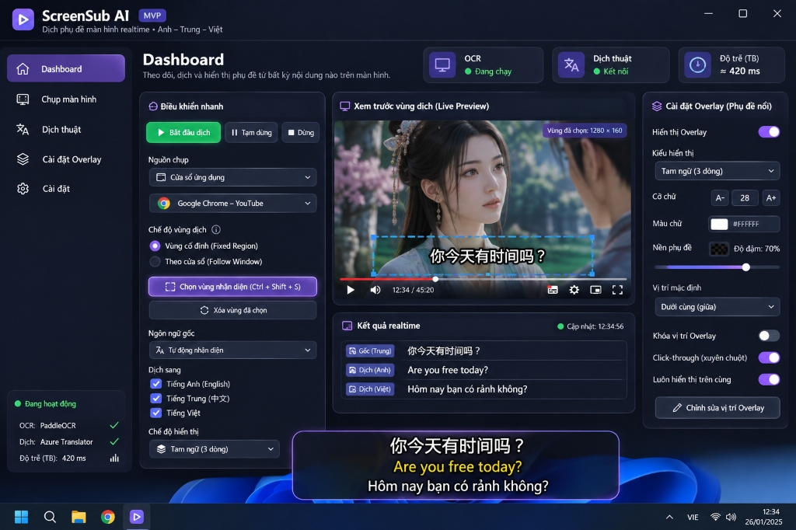

# ScreenSub AI — Windows Realtime Subtitle Translator



**ScreenSub AI** là ứng dụng Windows Desktop (WPF .NET 10) dịch phụ đề màn hình thời gian thực (Realtime Screen Subtitle Translator) hỗ trợ **Tiếng Anh (English)**, **Tiếng Trung (中文)** và **Tiếng Việt**. 

Ứng dụng cho phép bạn chọn một vùng phụ đề trên bất kỳ trình phát video nào (YouTube, Netflix, VLC, Chrome, game, v.v.), tự động nhận diện chữ bằng OCR cục bộ và dịch sang ngôn ngữ mong muốn với cửa sổ phụ đề nổi (Overlay) trong suốt, xuyên chuột (Click-through) và không làm gián đoạn trải nghiệm xem.

---

## Tính năng chính

- **Giao diện Dashboard Windows Hiện đại**: Thiết kế Dark Mode chuyên nghiệp, hiển thị trực quan thông số OCR, API dịch và độ trễ thực tế.
- **Chọn vùng màn hình (Snipping Tool Style)**:
  - Nhấn nút **Chọn vùng nhận diện** hoặc phím tắt **`Ctrl + Shift + S`** bất cứ lúc nào.
  - Lớp phủ mờ toàn màn hình, con trỏ crosshair, kéo thả chọn hình chữ nhật với viền neon cyan và hiển thị kích thước `W × H px` thời gian thực.
  - Nhấn `ESC` để hủy.
- **2 Chế độ theo dõi vùng dịch**:
  - **Vùng cố định (Fixed Region)**: Cố định tại tọa độ màn hình, phù hợp xem phim, YouTube.
  - **Theo cửa sổ (Follow Window)**: Tự động đi theo cửa sổ ứng dụng khi di chuyển hoặc thay đổi kích thước. Tự động tạm dừng nếu cửa sổ bị thu nhỏ (minimize).
- **Hỗ trợ đa màn hình & DPI Scaling**:
  - Hỗ trợ đầy đủ màn hình phụ có tọa độ âm.
  - DPI Awareness `PerMonitorV2` (100%, 125%, 150%) chuẩn xác theo từng pixel vật lý.
- **Realtime OCR Pipeline (PaddleOCR)**:
  - Xử lý cục bộ qua worker process (`workers/paddle-ocr/ocr_worker.py`).
  - Hỗ trợ chữ Trung (giản thể / phồn thể), Anh, Việt và ký tự Unicode.
  - **Phát hiện thay đổi khung hình (Frame Change Detection)**: Bỏ qua OCR khi hình ảnh không thay đổi để tiết kiệm tài nguyên CPU.
  - **Bộ lọc ổn định phụ đề (Stability Filter)**: Ghép dòng theo thứ tự đọc tự nhiên và chống giật/nhấp nháy chữ do sai lệch nhỏ giữa các khung hình liên tiếp.
- **AI Translation Engine (Azure AI Translator)**:
  - Tích hợp Azure AI Translator REST API v3.0 thực tế.
  - Hỗ trợ dịch giữa 3 ngôn ngữ: Anh ↔ Trung ↔ Việt.
  - Cơ chế tự động nhận diện ngôn ngữ (Auto Language Detection).
  - Bộ nhớ đệm (Translation Cache) chống gọi API trùng lặp.
  - Tích hợp sẵn **Mock Translation Provider** để thử nghiệm ngay lập tức khi chưa cấu hình API Key.
- **Cửa sổ phụ đề nổi (Subtitle Overlay Window)**:
  - Cửa sổ riêng biệt, trong suốt, borderless, luôn hiển thị trên cùng (Always on Top).
  - **Click-through (Xuyên chuột)**: Sử dụng `WS_EX_TRANSPARENT | WS_EX_LAYERED`, bấm chuột xuyên qua phụ đề xuống video bên dưới.
  - **Chống nhận diện ngược (Capture Exclusion)**: Sử dụng `SetWindowDisplayAffinity(hwnd, WDA_EXCLUDEFROMCAPTURE)` để Windows loại trừ cửa sổ phụ đề khỏi capture, ngăn chặn hoàn toàn vòng lặp OCR vô hạn.
  - 3 Chế độ hiển thị: **Một ngôn ngữ (Single)**, **Song ngữ (Dual)**, **Tam ngữ (Triple)**.
  - Tùy chỉnh cỡ chữ, màu sắc, độ đậm của nền và chế độ kéo thả tự do.
- **Bảo mật & Cài đặt**:
  - Khóa API được mã hóa an toàn trên máy cục bộ bằng **Windows DPAPI** (`ProtectedData`).
  - Lưu trữ cấu hình bằng SQLite và JSON nội bộ.

---

## Cấu trúc thư mục dự án

```text
ScreenSubAI/
├── src/
│   ├── ScreenSub.Core/           # Domain models, enums, interfaces
│   ├── ScreenSub.Capture/        # Screen capture, BitBlt, DPI scaling, window tracking
│   ├── ScreenSub.Ocr/            # PaddleOCR process worker, text normalizer, stability filter
│   ├── ScreenSub.Translation/    # Azure AI Translator, Mock provider, Translation cache
│   ├── ScreenSub.Overlay/        # Transparent overlay window, click-through, capture exclusion
│   ├── ScreenSub.Infrastructure/ # SQLite database, Windows DPAPI secret protection, Serilog
│   └── ScreenSub.Desktop/        # WPF MVVM Presentation layer, Dashboard UI, Hotkeys
├── workers/
│   └── paddle-ocr/               # Python worker script (ocr_worker.py) & requirements.txt
├── tests/
│   ├── UnitTests/                # Unit tests (xUnit, FluentAssertions)
│   └── IntegrationTests/         # Integration tests (DPAPI, SQLite, Providers)
├── docs/
│   └── ARCHITECTURE.md           # Tài liệu kiến trúc chi tiết
├── ScreenSubAI.slnx              # Solution file (.NET 10)
└── README.md
```

---

## Yêu cầu môi trường

- **Hệ điều hành**: Windows 10 (version 1903 trở lên) hoặc Windows 11 x64.
- **.NET SDK**: .NET 10.0 SDK.
- **Python**: Python 3.10+ x64 (nếu sử dụng PaddleOCR cục bộ).

---

## Hướng dẫn cài đặt & chạy

### 1. Build Solution

```powershell
# Restore và build toàn bộ solution
dotnet build ScreenSubAI.slnx
```

### 2. Chạy kiểm thử (Tests)

```powershell
dotnet test ScreenSubAI.slnx
```

Tất cả 15 unit tests và integration tests đều hoàn thành thành công:
```text
Passed! - UnitTests.dll (12 tests)
Passed! - IntegrationTests.dll (3 tests)
Total: 15 passed, 0 failed.
```

### 3. Cài đặt thư viện cho PaddleOCR Worker (Tùy chọn)

Để chạy nhận diện hình ảnh bằng PaddleOCR thật:

```powershell
pip install -r workers/paddle-ocr/requirements.txt
```

*(Lưu ý: Nếu chưa cài PaddleOCR, worker sẽ tự động phản hồi chế độ thử nghiệm để ứng dụng tiếp tục hoạt động mà không bị crash).*

### 4. Khởi chạy ứng dụng

```powershell
dotnet run --project src/ScreenSub.Desktop/ScreenSub.Desktop.csproj
```

Hoặc chạy trực tiếp file Release đã build:
```powershell
src\ScreenSub.Desktop\bin\Release\net10.0-windows\win-x64\publish\ScreenSub.Desktop.exe
```

---

## Phím tắt & Thao tác nhanh

| Thao tác | Phím tắt / Hành động | Mô tả |
|---|---|---|
| **Chọn vùng màn hình** | `Ctrl + Shift + S` | Kích hoạt công cụ chọn vùng kiểu Snipping Tool |
| **Hủy chọn vùng** | `ESC` | Thoát chế độ chọn vùng màn hình |
| **Bắt đầu dịch** | Nút `▶ Bắt đầu dịch` | Khởi động luồng capture, OCR và dịch thuật |
| **Tạm dừng / Dừng** | Nút `⏸` / `⏹` | Tạm dừng hoặc dừng dịch thuật |
| **Chỉnh vị trí Overlay** | Nút `✏ Chỉnh sửa vị trí Overlay` | Tắt click-through, cho phép kéo thả cửa sổ phụ đề |

---

## Cấu hình Azure Translator (Tùy chọn)

1. Nhấp vào tab **Cài đặt** ở thanh bên trái của Dashboard.
2. Nhập **Azure Translator API Key** và **Azure Region** (ví dụ: `eastasia`, `southeastasia`).
3. Tắt tùy chọn *Sử dụng Mock Translation*.
4. Nhấn **Lưu cài đặt**. Khóa API của bạn sẽ được tự động mã hóa bằng DPAPI.

---

## Giấy phép
Phát triển cho ScreenSub AI — Ứng dụng dịch phụ đề màn hình thời gian thực.
