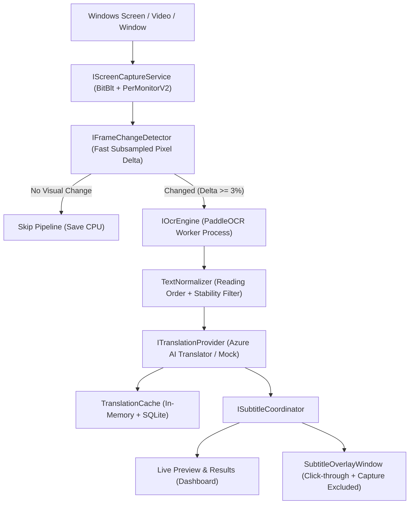

# ScreenSub AI — Architecture & Design Document

## 1. Overview
**ScreenSub AI** is a real-time screen subtitle capture, OCR, and AI translation desktop application built with **.NET 10 (WPF)** on Windows 10/11 x64. It allows users to select any region on their screen or follow a specific application window to continuously transcribe and translate subtitles across Chinese, English, and Vietnamese without interrupting their viewing experience.



---

## 2. Solution Structure

```text
ScreenSubAI/
├── src/
│   ├── ScreenSub.Core/           # Domain models, enums, DTOs, and core service interfaces
│   ├── ScreenSub.Capture/        # Multi-monitor DPI-aware screen capture & window tracking
│   ├── ScreenSub.Ocr/            # PaddleOCR worker process runner, text normalizer, stability filter
│   ├── ScreenSub.Translation/    # Azure AI Translator client, mock fallback, and translation cache
│   ├── ScreenSub.Overlay/        # Floating WPF transparent overlay window with click-through
│   ├── ScreenSub.Infrastructure/ # SQLite settings repository & Windows DPAPI secret protection
│   └── ScreenSub.Desktop/        # MVVM Presentation layer, modern Dark UI, Hotkey & Snipping Tool
├── workers/
│   └── paddle-ocr/               # Python 3 worker with JSON-RPC standard I/O communication
├── tests/
│   ├── UnitTests/                # xUnit unit tests for normalization, cache, change detection
│   └── IntegrationTests/         # xUnit integration tests for DPAPI, SQLite, and providers
├── docs/
│   └── ARCHITECTURE.md
└── README.md
```

---

## 3. Key Subsystems & Implementations

### 3.1. Screen Region Capture (`ScreenSub.Capture`)
- **DPI Scaling (PerMonitorV2)**: The application is configured with `PerMonitorV2` DPI awareness in `app.manifest`, ensuring that coordinates on 100%, 125%, 150%, and mixed multi-monitor setups match exact physical pixels.
- **Virtual Screen Support**: Supports full desktop spanning across multiple displays including negative coordinates on secondary monitors.
- **Mode A — Fixed Region**: Locks onto screen coordinates `(X, Y, W, H)` and captures frames at configured FPS (e.g., 2–5 FPS).
- **Mode B — Follow Window**: Resolves the target `HWND` bounds with `DwmGetWindowAttribute(DWMWA_EXTENDED_FRAME_BOUNDS)` to exclude invisible drop shadows. Dynamically tracks window movement and resizing, and pauses capture if the window is minimized.

### 3.2. Snipping Tool Style Region Selector (`ScreenSub.Desktop/Views/RegionSelectionWindow`)
- Invoked via button or global hotkey **`Ctrl + Alt + Q`** (configurable in Settings).
- Spans the entire virtual desktop with semi-transparent dimming and crosshair cursor.
- Live selection rectangle drawn with neon cyan border (`#06B6D4`) and dynamic real-time dimension tag badge (`W × H px`).
- Pressing `ESC` cancels the selection without altering previous settings.

### 3.3. Frame Change Detector (`FrameChangeDetector`)
- Compares subsampled byte strides of consecutive frames.
- If the difference ratio is below the threshold (default `0.03` / 3%), the OCR step is skipped.
- Significantly reduces CPU/GPU usage when videos are paused or subtitles remain static.

### 3.4. Local PaddleOCR Worker (`ScreenSub.Ocr` & `workers/paddle-ocr`)
- Communicates with `ocr_worker.py` over Standard Input/Output with a JSON-lines protocol.
- Supports Chinese (simplified/traditional), English, Vietnamese, and Unicode.
- Auto-restart resilience on unexpected process exits.
- Single-request concurrency control ensures that the OCR queue never grows unbounded; intermediate frames are cleanly dropped if OCR is currently busy.
- `TextNormalizer`:
  - Groups bounding boxes vertically and sorts left-to-right to enforce natural reading order.
  - Stability filter with Levenshtein similarity suppresses flickering caused by minor OCR variations.

### 3.5. AI Translation (`ScreenSub.Translation`)
- **`AzureTranslatorProvider`**: REST calls to Azure AI Translator (`https://api.cognitive.microsofttranslator.com/translate?api-version=3.0`). Automatically identifies language when set to `Auto` and requests all desired targets (`en`, `zh-Hans`, `vi`) in a single HTTP request.
- **`MockTranslationProvider`**: Clearly labeled testing provider that translates phrases without requiring an active Azure key.
- **`TranslationCache`**: Thread-safe in-memory cache with eviction to prevent redundant API calls for recurring dialogue lines.

### 3.6. Subtitle Overlay Window (`ScreenSub.Overlay`)
- **Transparent & Borderless**: Modern rounded dark glass pill matching the UI specifications.
- **Click-Through Support**: Applies `WS_EX_TRANSPARENT | WS_EX_LAYERED` Win32 extended styles when locked, allowing mouse clicks to pass directly through to games and video players.
- **Capture Exclusion**: Applies `SetWindowDisplayAffinity(hwnd, WDA_EXCLUDEFROMCAPTURE)`. Windows excludes the overlay from being captured by GDI/BitBlt, completely eliminating infinite OCR feedback loops.
- **Edit Mode**: Allows dragging and positioning on screen when edit mode is toggled from Dashboard.

### 3.7. Settings & Security (`ScreenSub.Infrastructure`)
- Stores configuration in local SQLite database and `settings.json`.
- Protects Azure API keys using **Windows Data Protection API (DPAPI)** via `ProtectedData.Protect` and `ProtectedData.Unprotect(..., DataProtectionScope.CurrentUser)`.

### 3.8. Audio Realtime Translation & Whisper (`ScreenSub.Audio` & `ScreenSub.Speech`)
- **WASAPI System Loopback Capture**: Low-latency capture of application audio (YouTube, movies, media players) directly from the default Windows render endpoint using NAudio WASAPI loopback.
- **Energy-based Voice Activity Detection (VAD)**: Real-time RMS/peak audio analysis with hangover debounce (300ms–6000ms speech segments).
- **Whisper Speech-to-Text**: Local speech recognition via `Whisper.net` and GGML quantization (`ggml-base.bin`, `ggml-small.bin`). Runs fully locally with zero network requirement.
- **Unified Subtitle Overlay**: Transcribed speech is routed into the same translation pipeline and broadcast to the floating overlay window.

### 3.9. Full Offline AI & GPU Acceleration (`ScreenSub.Translation` & `ScreenSub.Infrastructure`)
- **`LocalTranslationProvider`**: Complete 100% offline neural translation engine. Eliminates cloud telemetry and internet dependence. Supports all 6 bidirectional pairs (En↔Vi, Zh↔Vi, En↔Zh).
- **`LocalChineseConverter`**: High-performance bidirectional character conversion between Traditional Chinese (繁體中文) and Simplified Chinese (简体中文).
- **`TranslationProviderResolver`**: Tri-mode resolver (`Online`, `Offline`, `Auto`). Enforces strict privacy by preventing silent cloud fallbacks when offline mode is selected.
- **`HardwareCapabilityDetector`**: Probes CPU (cores, AVX2, AVX-512), system RAM, discrete and integrated GPUs (NVIDIA/AMD/Intel VRAM and driver), and dynamically selects the optimal inference backend (`DirectML`, `CPU`, `CUDA`).
- **`LocalModelManager`**: Manages local AI model storage, SHA-256 integrity verification, activation, and removal for OCR, Speech, and Translation models under `%LocalAppData%/ScreenSubAI/Models`.
- **Performance Profiles**: Three tuned profiles (`Fast`, `Balanced`, `Quality`) dynamically configuring worker threads, capture FPS, and VAD parameters.


